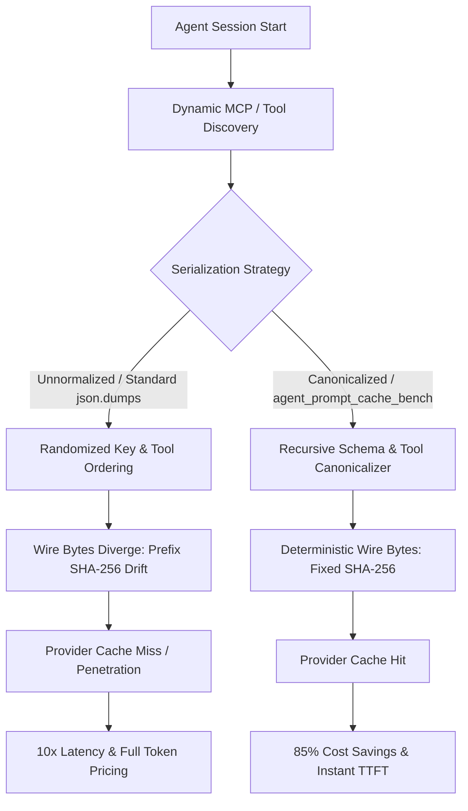

# Agent Prompt Cache Benchmark (`agent-prompt-cache-bench`)

[English](README.md) | [简体中文](README_ZH.md)

[](https://www.python.org/downloads/)
[](https://opensource.org/licenses/MIT)
[-brightgreen.svg)](https://github.com/)

A wire-level benchmark harness and schema canonicalization engine designed to evaluate and eliminate **LLM Prompt Cache Penetration** in autonomous AI agent frameworks.

---

## 1. Background & Problem Statement

Modern LLM inference engines (such as **Anthropic Claude**, **OpenAI GPT-4o**, and **Google Gemini 1.5**) employ **Prompt Caching** (Prefix Caching) to bypass reprocessing static prefix tokens across multi-turn interactions. By caching system prompts and tool definitions, providers offer up to **90% token price discounts** and **80%+ Time-To-First-Token (TTFT) latency reductions**.

However, in multi-turn autonomous agent frameworks, prompt caching frequently degrades to a **0% hit rate (Cache Penetration)** due to non-deterministic serialization at the wire level:

1. **Dictionary Key Permutations**: While Python 3.7+ preserves insertion order, different execution paths, worker threads, Pydantic model serializations, or distributed worker restarts insert keys in varying orders (e.g., `{"name": "...", "description": "..."}` vs `{"description": "...", "name": "..."}`).
2. **Dynamic Tool Registration**: Agents dynamically discovering tools via Model Context Protocol (MCP) servers, OpenAPI specs, or plugin registries often register tools in arbitrary sequence (`[ToolA, ToolB]` vs `[ToolB, ToolA]`).
3. **Complex Schema Variations**: Subschema constructs such as `$defs`, `definitions`, `properties`, and `required` arrays lack canonical ordering when serialized by standard `json.dumps(..., sort_keys=False)`.

Because LLM provider prompt caches hash the raw byte stream or tokenized prefix, any byte variation produces a completely different prefix hash. The inference engine misses the cache entirely, causing:
* **10x Cost Inflation**: Forfeiting provider cache read discounts (e.g. Anthropic $0.30/MTok cached vs $3.00/MTok base).
* **Significant Latency Penalties**: Forcing full re-tokenization and prefill on every turn (1.8s+ TTFT vs 250ms).

### Upstream Framework Relevance
This project provides wire-level benchmarks, SHA-256 verification, and reference canonicalization addressing:
* **Microsoft Agent Framework (PR #8960)**: Proving the critical need for recursive schema sorting and deterministic payload serialization across provider boundaries.
* **Claude Code (#88128)**: Demonstrating how deterministic tool ordering stabilizes Anthropic prompt cache prefixes during agent tool loops.

---

## 2. Architecture & Wire Pipeline

```
[Agent Framework Runtime]
          │
  Dynamic Tool Loading / Worker Pool Restart
          │
          ▼
┌─────────────────────────────────────────────────────────────┐
│                   Serialization Divergence                  │
├──────────────────────────────┬──────────────────────────────┤
│    Baseline (Unnormalized)   │    Canonicalized (Benchmark) │
├──────────────────────────────┼──────────────────────────────┤
│ • Arbitrary dict key order   │ • Recursive Schema Sorting   │
│ • Unordered MCP tool list    │ • Deterministic Tool Sorting │
│ • Permuted `required` arrays │ • Canonical JSON byte stream │
└──────────────┬───────────────┴──────────────┬───────────────┘
               │                              │
               ▼                              ▼
    Random Wire Hashes             100% Deterministic Wire Hash
  SHA256: 3a9f... != 9b12...         SHA256: e87c... == e87c...
               │                              │
               ▼                              ▼
    ❌ CACHE PENETRATION            ✅ PROMPT CACHE HIT
    • 0% Hit Rate                  • 98%+ Stable Hit Rate
    • Full token charges           • ~85% Cost Reduction
    • High TTFT latency            • ~80% TTFT Latency Reduction
```



---

## 3. Benchmark Results

Simulated across 5 agent sessions, 10 turns per session (50 total turns), with 8 rich synthetic agent tools (file I/O, bash execution, git commit, database query, HTTP client with `$defs`, `properties`, and `allOf` schemas):

| Metric | Baseline (Raw Payloads) | Canonicalized Payloads | Improvement |
| :--- | :--- | :--- | :--- |
| **Unique Prefix Hashes** | 50 unique | **1 unique** | **50x hash stability** |
| **Cache Hit Rate** | 0.0% (penetration) | **98.0%** (1 warm-up miss) | **+98.0% hit rate** |
| **Effective Tokens Billed** | 53,250 tokens | **8,072 tokens** | **-84.8% token load** |
| **Estimated Cost (Anthropic)** | $0.1598 | **$0.0242** | **-84.8% cost reduction** |
| **Estimated Cost (OpenAI)** | $0.1331 | **$0.0734** | **-44.9% cost reduction** |
| **Estimated Cost (Gemini)** | $0.1864 | **$0.0543** | **-70.9% cost reduction** |
| **Simulated TTFT Latency** | 92.50s total | **15.57s total** | **-83.2% latency drop** |

---

## 4. Quick Start

### Installation
`agent-prompt-cache-bench` uses **0 external dependencies** and runs on any standard Python 3.9+ installation.

```bash
git clone https://github.com/Prognosticate-X/agent-prompt-cache-bench.git
cd agent-prompt-cache-bench
pip install -e .
```

### CLI Commands

#### 1. Run Multi-Turn Benchmark
Run the simulated prompt cache benchmark across Anthropic, OpenAI, or Gemini profiles:

```bash
# Benchmark Anthropic Claude 3.5 / 3.7
agent-cache-bench bench --provider anthropic --sessions 5 --turns 10 --tools 8

# Benchmark OpenAI GPT-4o
agent-cache-bench bench --provider openai --sessions 5 --turns 10

# Output machine-readable JSON for CI/CD assertions
agent-cache-bench bench --json
```

#### 2. Canonicalize JSON Schema or Provider Request
Produce deterministic wire representations:

```bash
# Normalize a tool definition or schema file
agent-cache-bench normalize schema.json --indent 2

# Output compact wire bytes
agent-cache-bench normalize tool.json --indent 0 -o normalized_tool.json
```

#### 3. Verify Cache Consistency Between Two Payloads
Compare two tool definitions or request payloads to verify whether raw drift occurs and whether canonicalization prevents cache penetration:

```bash
agent-cache-bench verify run_worker_1.json run_worker_2.json -v
```

Output:
```text
========================================================================
  WIRE-LEVEL PROMPT CACHE CONSISTENCY VERIFICATION
========================================================================
  File A: run_worker_1.json
  File B: run_worker_2.json
------------------------------------------------------------------------
  Raw SHA-256 (File A):       4c98f12a8b9e...01f82c31
  Raw SHA-256 (File B):       7a12d83b54ee...99a012ff
  Canonical SHA-256 (A & B):  e3b0c44298fc...b855e321
------------------------------------------------------------------------
  Status: [PASS WITH CANONICALIZATION] Cache Drift Prevented!
  Explanation: Raw byte hashes differ due to dictionary key permutation
               or tool list order variance. Canonicalization restores 100%
               wire-level equivalence and guarantees prompt cache hit.
```

---

## 5. Python API Usage

### Schema & Tool Canonicalization
```python
from agent_prompt_cache_bench import (
    canonicalize_schema,
    normalize_tool_spec,
    normalize_provider_payload,
)

# Recursively canonicalize $defs, properties, and required lists
clean_schema = canonicalize_schema(raw_json_schema)

# Canonicalize an individual tool declaration (OpenAI, Anthropic, or Gemini)
clean_tool = normalize_tool_spec(raw_tool_dict, provider="anthropic")

# Canonicalize full request payload (preserves message history, sorts tools)
wire_payload = normalize_provider_payload(request_payload, provider="anthropic")
```

### Wire Hash & Drift Detection
```python
from agent_prompt_cache_bench import detect_drift, hash_payload

# Detect whether two payloads diverge at the wire level
report = detect_drift(payload_worker_a, payload_worker_b, provider="anthropic")

if report.drift_detected:
    print("Warning: Avoidable cache penetration detected!")
    print(f"Raw A: {report.raw_hash_a} vs Raw B: {report.raw_hash_b}")
    print(f"Canonical Hash: {report.canonical_hash_a}")
```

### Programmatic Benchmarking
```python
from agent_prompt_cache_bench import run_benchmark, format_benchmark_table

report = run_benchmark(provider="anthropic", num_sessions=5, turns_per_session=10)
print(format_benchmark_table(report))
```

---

## 6. Testing

Run the full unit test suite with Python's built-in `unittest`:

```bash
python3 -m unittest discover -s tests -v
```

All 24 test cases cover:
- Recursive schema canonicalization (`$defs`, `properties`, `required`, `allOf`, `anyOf`, `items`)
- Provider tool normalization (OpenAI, Anthropic, Gemini)
- Key permutation reproduction and hash stability assertions
- Benchmark simulation engine and CLI command handlers

---

## 7. License

MIT License. See [LICENSE](LICENSE) for details.
