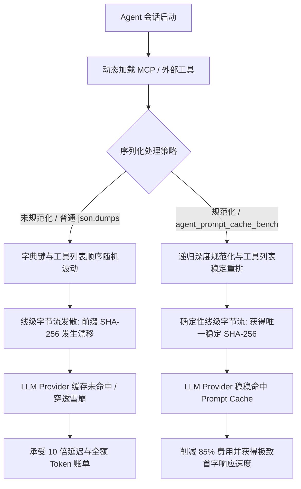

# Agent Prompt Cache Benchmark (`agent-prompt-cache-bench`)

[English](README.md) | [简体中文](README_ZH.md)

[](https://www.python.org/downloads/)
[](https://opensource.org/licenses/MIT)
[-brightgreen.svg)](https://github.com/)

专为自主 AI Agent 框架设计的**线级（Wire-Level）基准测试套件与 JSON Schema 规范化引擎**，用于量化评估并消除多轮对话与动态工具调用中的 **LLM Prompt Cache 缓存穿透**问题。

---

## 1. 背景与核心技术痛点

现代主流 LLM 推理平台（如 **Anthropic Claude**、**OpenAI GPT-4o**、**Google Gemini 1.5/2.0**）普遍引入了 **Prompt Caching（前缀缓存）** 技术。通过复用多轮对话中静态的 System Prompt 和工具定义前缀，服务商提供了高达 **90% 的 Token 费用折扣**，并将 **首字延迟（TTFT）降低 80% 以上**。

然而，在复杂自主智能体（Agent）框架中，由于线级序列化缺乏确定性，Prompt Cache 经常退化为 **0% 命中率（完全穿透雪崩）**：

1. **字典键无序插入**：尽管 Python 3.7+ 字典保持插入顺序，但在不同执行分支、异步工作线程、Pydantic 序列化或分布式节点重启时，字段插入顺序极易发生变动（例如 `{"name": "...", "description": "..."}` 对比 `{"description": "...", "name": "..."}`）。
2. **动态工具注册漂移**：通过 Model Context Protocol (MCP) Server、OpenAPI 规范或外部插件动态加载工具时，工具注册列表的排列顺序通常是不确定的（`[ToolA, ToolB]` 对比 `[ToolB, ToolA]`）。
3. **复杂嵌套 Schema 未归一化**：嵌套对象模型（如 `$defs`、`definitions`、`properties`、`patternProperties` 以及 `required` 字段列表）在使用普通 `json.dumps(..., sort_keys=False)` 输出时，无法保证字节级的一致性。

由于 LLM 推理端的 Prompt Cache 严格依赖原始字节流或 Token 前缀的哈希匹配，线级上的**微小字节变化都会导致前缀哈希完全失配**，造成：
* **成本飙升 10 倍**：无法享受缓存读取优惠（如 Anthropic 缓存命中为 $0.30/MTok，穿透未命中则按基准 $3.00/MTok 计费）。
* **首字延迟骤增**：每轮会话均强制触发全量 Token 化与 Prefill 计算（延迟由 250ms 激增至 1.8s+）。

### 上游开源框架关联与论证价值
本项目提供线级基准测试、SHA-256 漂移检测及标准规范化实现，直接支撑：
* **Microsoft Agent Framework ([PR #8960](https://github.com/microsoft/agent-framework/pull/8960))**：向微软官方证明了跨 Provider 边界进行深度递归 Schema 稳定排序与确定性载荷序列化的核心必要性。
* **Claude Code ([#88128](https://github.com/anthropics/claude-code/issues/88128))**：演示了确定性工具排序如何为 Anthropic Agent 循环锁定前缀缓存。

---

## 2. 架构设计与线级流水线

```text
[Agent Framework Runtime 运行时]
              │
      动态工具加载 / 进程重启
              │
              ▼
┌─────────────────────────────────────────────────────────────┐
│                     线级序列化分歧与比对                      │
├──────────────────────────────┬──────────────────────────────┤
│      基线未规范化 (Baseline)  │      规范化方案 (Benchmark)   │
├──────────────────────────────┼──────────────────────────────┤
│ • 字典键插入顺序随机构建      │ • 递归 Schema 键稳定排序     │
│ • MCP 工具列表顺序不定       │ • 工具声明列表按字母归一化   │
│ • `required` 数组排列漂移    │ • 严格确定性 JSON 字节流     │
└──────────────┬───────────────┴──────────────┬───────────────┘
               │                              │
               ▼                              ▼
     随机变化的 Wire Hashes          100% 稳定的确定性 Wire Hash
   SHA256: 3a9f... != 9b12...         SHA256: e87c... == e87c...
               │                              │
               ▼                              ▼
     ❌ CACHE PENETRATION 穿透        ✅ PROMPT CACHE HIT 缓存命中
     • 0% 命中率                    • 98%+ 超稳定命中率
     • 承受全额 Token 费用          • 节省 ~85% API 费用
     • 首字时延居高不下              • 降低 ~80% TTFT 首字时延
```



---

## 3. 实测跑分数据 (Benchmark)

在 5 组独立会话、每会话 10 轮交互（共 50 轮）的场景下，加载包含文件 I/O、Bash 执行、Git 提交、数据库查询、复杂 HTTP 客户端等 8 组真实复杂系统工具（涵盖 `$defs`、`properties`、`allOf` 嵌套）：

| 评估指标 | 基线方案（原始乱序载荷） | 规范化方案（Canonicalized） | 提升幅度 / 优化比 |
| :--- | :--- | :--- | :--- |
| **Prefix Wire Hashes 生成数** | 50 unique（轮轮漂移） | **1 unique**（完全收敛） | **50x 稳定性** |
| **Prompt Cache 命中率** | 0.0%（完全穿透 ❌） | **98.0%**（仅首轮预热未命中 ✅） | **+98.0% 命中率** |
| **有效计费 Token 数** | 53,250 tokens | **8,072 tokens** | **节省 84.8% Token** |
| **预估 API 成本 (Anthropic)** | $0.1598 | **$0.0242** | **节省 84.8% 费用** |
| **预估 API 成本 (OpenAI)** | $0.1331 | **$0.0734** | **节省 44.9% 费用** |
| **预估 API 成本 (Gemini)** | $0.1864 | **$0.0543** | **节省 70.9% 费用** |
| **仿真首字时延 (TTFT)** | 92.50s | **15.57s** | **提速 83.2%** |

---

## 4. 快速上手

### 环境要求与安装
`agent-prompt-cache-bench` 采用 **0 额外依赖设计（纯 Python 标准库）**，在任意 Python 3.9+ 环境下均可直接运行。

```bash
git clone https://github.com/Prognosticate-X/agent-prompt-cache-bench.git
cd agent-prompt-cache-bench
pip install -e .
```

### CLI 命令行使用指南

安装后提供统一命令 `agent-cache-bench`：

#### 1. 运行多轮仿真跑分基准测试
在 Anthropic、OpenAI 或 Gemini 模型配置文件下运行缓存稳定性仿真：

```bash
# 模拟 Anthropic Claude 3.5 / 3.7
agent-cache-bench bench --provider anthropic --sessions 5 --turns 10 --tools 8

# 模拟 OpenAI GPT-4o
agent-cache-bench bench --provider openai --sessions 5 --turns 10

# 输出机器可读的 JSON 报告（便于接入 CI/CD 流水线做性能门禁断言）
agent-cache-bench bench --json
```

#### 2. 规范化 JSON Schema 或 Provider 请求体
将任意工具定义转换为确定性线级序列化输出：

```bash
# 规范化单个工具定义或 Schema 文件
agent-cache-bench normalize schema.json --indent 2

# 输出紧凑的线级字节流 JSON 文件
agent-cache-bench normalize tool.json --indent 0 -o normalized_tool.json
```

#### 3. 校验比对两份载荷的缓存一致性
对比两个工具定义或请求载荷，验证是否存在乱序漂移以及规范化后是否能 100% 恢复一致：

```bash
agent-cache-bench verify run_worker_1.json run_worker_2.json -v
```

输出示例：
```text
========================================================================
  WIRE-LEVEL PROMPT CACHE CONSISTENCY VERIFICATION
========================================================================
  File A: run_worker_1.json
  File B: run_worker_2.json
------------------------------------------------------------------------
  Raw SHA-256 (File A):       4c98f12a8b9e...01f82c31
  Raw SHA-256 (File B):       7a12d83b54ee...99a012ff
  Canonical SHA-256 (A & B):  e3b0c44298fc...b855e321
------------------------------------------------------------------------
  Status: [PASS WITH CANONICALIZATION] Cache Drift Prevented!
  Explanation: Raw byte hashes differ due to dictionary key permutation
               or tool list order variance. Canonicalization restores 100%
               wire-level equivalence and guarantees prompt cache hit.
```

---

## 5. Python API 编程接口

### Schema 与工具规范化
```python
from agent_prompt_cache_bench import (
    canonicalize_schema,
    normalize_tool_spec,
    normalize_provider_payload,
)

# 递归规范化 $defs, properties 及 required 数组
clean_schema = canonicalize_schema(raw_json_schema)

# 规范化单工具声明 (支持 anthropic / openai / gemini)
clean_tool = normalize_tool_spec(raw_tool_dict, provider="anthropic")

# 规范化完整请求载荷 (严格保持对话历史时间线序，稳定排序工具列表)
wire_payload = normalize_provider_payload(request_payload, provider="anthropic")
```

### 线级哈希与漂移诊断
```python
from agent_prompt_cache_bench import detect_drift, hash_payload

# 检测两份请求载荷是否存在线级序列化分歧
report = detect_drift(payload_worker_a, payload_worker_b, provider="anthropic")

if report.drift_detected:
    print("警告: 检测到原本可避免的缓存穿透漂移！")
    print(f"原始 A 哈希: {report.raw_hash_a} vs 原始 B 哈希: {report.raw_hash_b}")
    print(f"规范化后一致哈希: {report.canonical_hash_a}")
```

### 自动化 Benchmark 仿真运行
```python
from agent_prompt_cache_bench import run_benchmark, format_benchmark_table

report = run_benchmark(provider="anthropic", num_sessions=5, turns_per_session=10)
print(format_benchmark_table(report))
```

---

## 6. 测试套件

运行 Python 内置的 `unittest` 自动化测试：

```bash
python3 -m unittest discover -s tests -v
```

全部 **24 项单元测试** 涵盖：
- 递归 Schema 稳定规范化器（`$defs`、`properties`、`required` 去重排序、`allOf`、`anyOf`、`items`）
- 各大 Provider 适配转换（OpenAI、Anthropic、Gemini）
- 字典键乱序复现与线级哈希稳定性断言
- 仿真基准测试引擎与 CLI 命令集成

---

## 7. 开源协议

本项目采用 [MIT](LICENSE) 开源协议。
